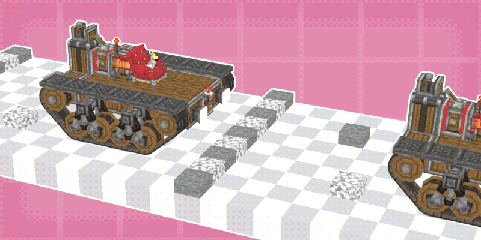
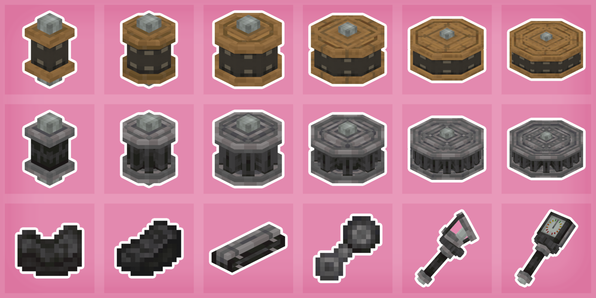
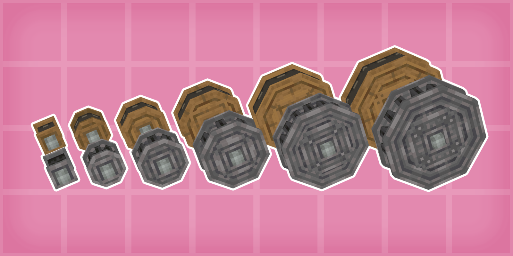
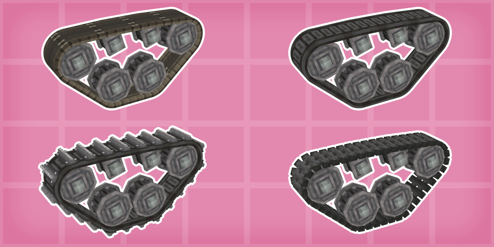
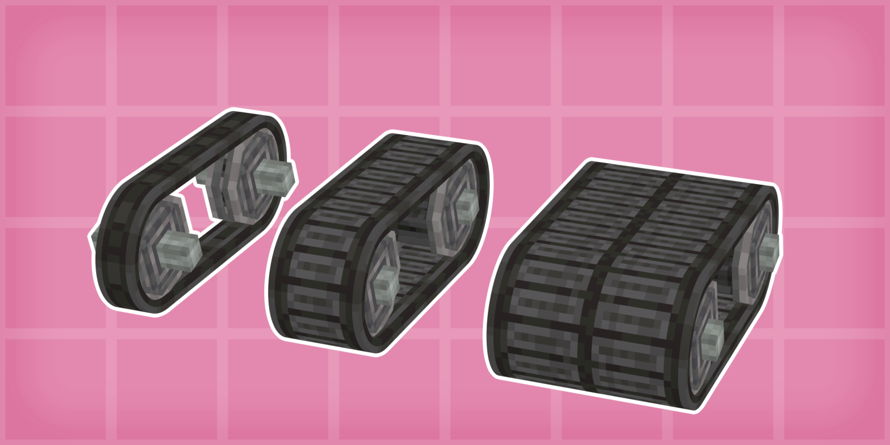
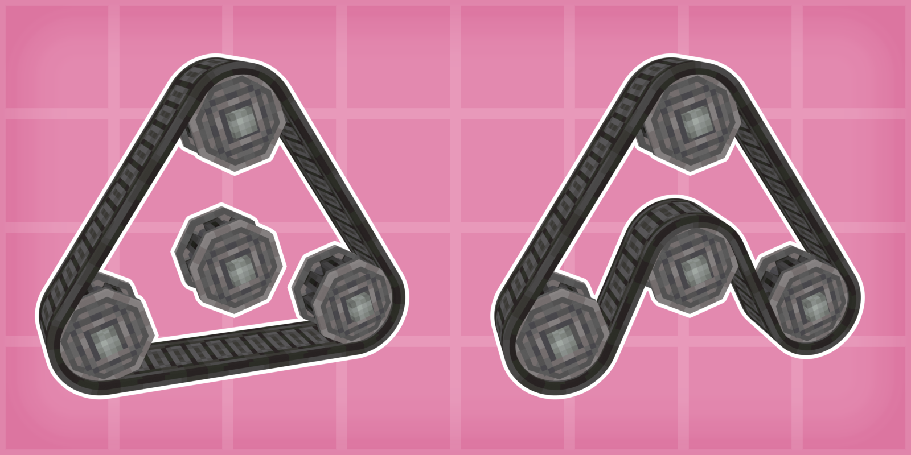
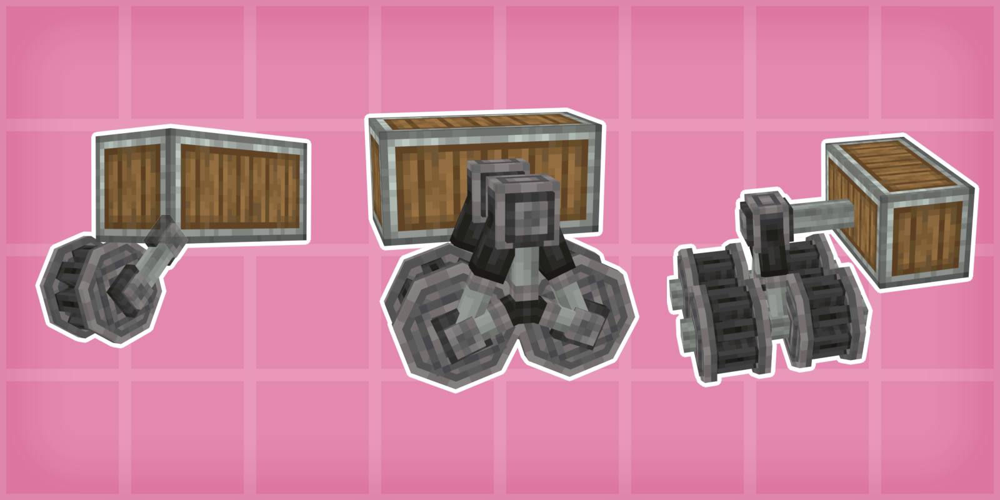
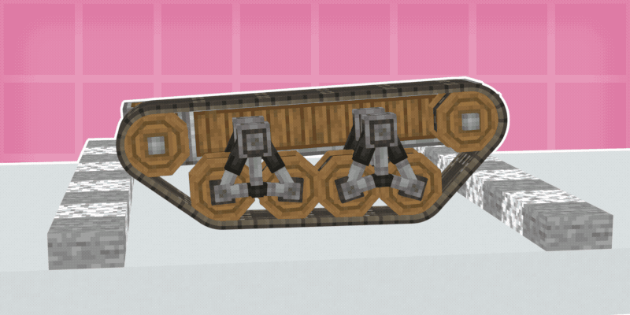
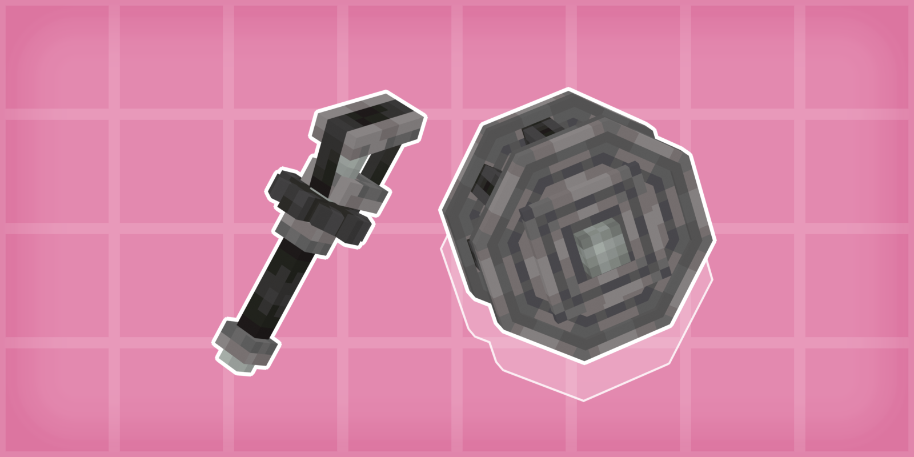
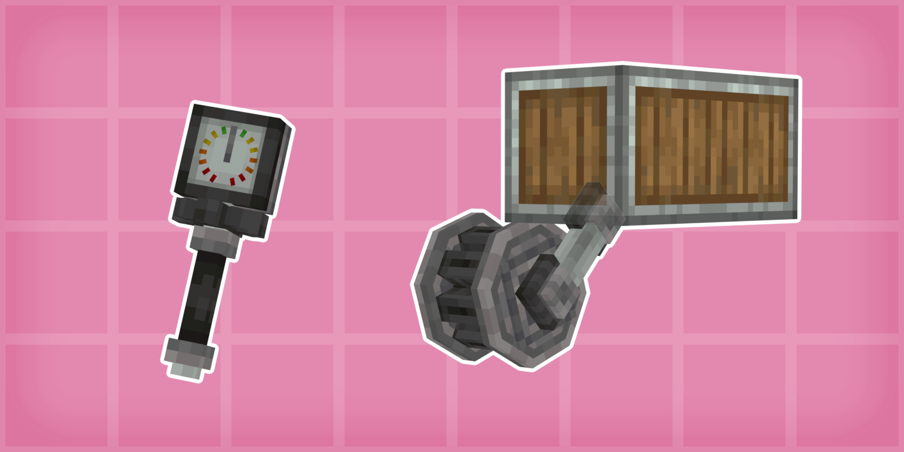

# Create: Bits 'n' Tracks Community Edition

[](https://modrinth.com/mod/bits-n-tracks-ce)
[](https://www.curseforge.com/minecraft/mc-mods/bits-n-tracks-ce)
[](https://github.com/Atmerek/bits-n-tracks-ce)
[](https://neoforged.net)
[](https://modrinth.com/mod/create)
[](https://discord.gg/CxTmpvp6gs)



Build working tank tracks in Create.
Flanged cogwheels carry a belt or tread around them, and on a Sable vehicle the track grips the ground, drives it along and rides over what it crosses.

This is a community continuation of [**Bits 'n' Tracks**](https://modrinth.com/mod/create-bits-n-tracks) by *qwxon*, picking up development where the original left off.

## Requirements

* Minecraft 1.21.1 with NeoForge 21.1.228 or newer
* [Create](https://modrinth.com/mod/create) 6.0.10 or newer
* [Sable](https://modrinth.com/mod/sable) 2.0.x
* [Create: Bits 'n' Bobs](https://modrinth.com/mod/create-bits-n-bobs) 2.3.5 or newer, with its own dependencies
* [Create Aeronautics](https://modrinth.com/mod/create-aeronautics) 1.3.1 or newer, for assembling vehicles and for the spring in the Suspension Piece recipe

## What's inside



* **Flanged cogwheels** in six sizes, plain and industrial, that carry a track
* **Three tracks**: Create's own belt, the Industrial Belt and the Tank Tread, plus grousers for the belts
* **Suspension Pieces** that mount swinging arms and bogies
* **Two tools**, the Cog Alignment Lever to shape a track and the Suspension Tool to tune its ride

## Flanged cogwheels



Six sizes: tiny, intermediate, small, medium, medium-large and large, each in a plain and an industrial style.
The industrial models are based on the Industrial Cogwheels from Create: Gears n' Kinetics.

A placed cogwheel drives its track and turns through its axle.
Switch physics on with the Cog Alignment Lever and it becomes a wheel of its Sable vehicle: it stands on the ground, blocks players and other entities, and can carry a Suspension Piece.

## Tracks



Every track is strung between cogwheels like a Bits 'n' Bobs chain.

* **Create's belt**: a belt connector makes a track right away, no extra crafting needed.
* **Industrial Belt**: the mod's own belt, made from belt connectors and iron nuggets.
* **Tank Tread**: a plated track made in a Mechanical Crafter, which bites into soft ground better and grips a little less on hard ground.
* **Grousers**: right-click either belt with them to fit them along it. A belt with grousers grips much better on ice, snow and mud and a little worse on hard ground.

A track grips by the weight resting on it, and less on dirt, sand, gravel, clay, snow and mud than on stone.
Datapacks can change the grip of any block.
The run of track between cogwheels drapes over terrain and carries the vehicle over obstacles.

## Driving

A track runs at the speed of its links, set by the size and rotational speed of its cogwheels, and pushes the vehicle to match it.
How hard it can push is limited by its grip on the ground and by the stress impact of the cogwheels it wraps.
A heavy vehicle on few or small cogwheels therefore speeds up slowly and struggles up slopes, while more or bigger cogwheels on a track push harder.
The Drive Force per Stress setting sets how much push each point of stress impact gives, and 0 removes that limit.
Braking and holding still on a slope only depend on grip.
A redstone brake on any of a track's cogwheels brakes the whole track.

Steer by running the tracks at different speeds, for example by slowing, stopping or reversing one side.
The vehicle turns at the rate that speed difference asks for, within two limits:

* While moving, it turns no tighter than its tracks' sideways grip can hold, so a fast vehicle runs wide instead of spinning out.
* In place, it spins no faster than the Max Turn Rate setting, 120 degrees per second by default.

Past those limits the tracks slip on the ground instead of turning the vehicle harder.
When the tracks run straight again, they first stop the vehicle sliding sideways, then speed it back up.

## Wide wheels



Place a cogwheel beside another of the same size and style along its axle and they join into one wide wheel, with the track widening to match.
Sneak while placing to keep them apart.
The lever's Width mode narrows a cogwheel a quarter at a time, and a track is always as wide as its widest cogwheel.

## Routing



The track wraps around its cogwheels the way a real track sits on its road wheels.
A cogwheel inside the loop that the track cannot reach is enclosed by it, and turns freely until the track touches it.

With the lever's Route mode, bring the far run of track around any cogwheel instead.
That cogwheel then turns the other way, like a belt crossed over a pulley.

## Suspension



A **Suspension Piece** gives a physics cogwheel a sprung mount.

* **Arm**: right-click a physics cogwheel of any size to select it, then look beside it and right-click where the green preview fits. The arm pivots on the cogwheel's top corner, which needs a block touching it along the axle, and the lever's Pivot mode can move that hinge. If blocks on both sides could hold it, it mounts on the side you are looking toward. Uses one piece.
* **Bogie**: select a small, intermediate or tiny physics cogwheel, then right-click the one of the same size next to it. The bogie hangs from a block right above either cogwheel, or one next to that spot along the axle, and blocks can sit on top of it. Uses two pieces.
* **Wide bogie**: the same between two two-wide small, intermediate or tiny cogwheels, each pair turning into two separate wheels with the bogie between them. Uses two pieces.



Shift + right-click the cogwheel with an empty hand to take a piece or bogie back off.
A mount whose supporting block is removed drops its pieces.

## Getting started

Every part of the mod has a Ponder scene.
Hold the Ponder key (W by default) over a flanged cogwheel, a track, the Cog Alignment Lever, a Suspension Piece or the Suspension Tool.
The scenes walk through building a tracked vehicle, from placing and powering the cogwheels to tuning its suspension.

## The Cog Alignment Lever



The main tool of the mod.
It adjusts cogwheels after they are placed, narrows or hides them, routes and tensions the track, and switches physics on or off.
It only acts on Bits 'n' Tracks cogwheels and the tracks running on them, and breaks other blocks as normal.
While you hold it, a panel beside the hotbar shows the current mode, the values of what you are working on, and what to click or scroll.
Hold Alt (Create's tool menu key) and scroll to switch modes.
Without a scroll wheel, bind Next and Previous Tool Mode and Scroll Up and Down with a Tool under Bits 'n' Tracks in Controls; they work with both tools.

* **Offset**: right-click a cogwheel to select it, then scroll to move it one pixel at a time. Shift + scroll picks the axis: along the axle, across, or up and down. The last row, Track, switches the whole track between following its cogwheels and staying straight: a straight track runs down the middle of its cogwheels and widens to cover all of them, so they can slide along their axles beneath it, as interleaved road wheels need. On a straight track, one more row, Fit, leaves the selected cogwheel out of that width and centre, so thinner interleaved wheels can sit inside a track sized by the wheels at its ends.
* **Pivot**: right-click the hinge of a suspension arm or bogie to select it, then scroll to move it one pixel at a time, up to a block each way. Shift + scroll picks the axis. Moving an arm's hinge up, down or across changes the arm's length and angle, and so the path its wheel travels. Moving a bogie's hinge up or down changes the angle of its arms, and moving it across shifts the whole bogie with its wheels. Moving either along the axle only shifts where it meets its mount.
* **Route**: right-click a face to bring the far run of track around the cogwheel, so clicking the top wraps the bottom track over it, and reverses its spin. The centre puts its routing back to automatic.
* **Tension**: right-click a track to select it, then scroll to tighten it, so it holds its line, or slacken it, so it sags and follows the ground.
* **Visibility**: right-click a cogwheel to show or hide it.
* **Physics**: right-click a cogwheel to switch its physics on or off.
* **Width**: right-click a cogwheel to narrow it a quarter at a time, and Shift + right-click to widen it. A track is as wide as its widest cogwheel.
* **Shaft**: right-click either end of a cogwheel to hide or show its shaft there. A hidden shaft connects to nothing, so a cogwheel without shafts only turns with its track.
* **Reset**: right-click a cogwheel twice to reset alignment, hinges, the Track and Fit rows, visibility, track routing and suspension tuning.

Ctrl + left-click switches Offset, Pivot, Width, Shaft and Reset between one cogwheel and the whole track. On the whole track, Offset only moves the cogwheels that share the clicked one's physics setting.

## The Suspension Tool



The Suspension Tool reads and tunes cogwheels that carry a Suspension Piece.
It has four settings, stiffness, damping, travel and spring strength, each on levels 1 to 15 like a redstone signal, with 8 as the default.
It uses the same panel as the lever, with one mode per setting.

* **Look at a suspended cogwheel**: the panel and the dial show its levels.
* **Hold Alt and scroll**: switches setting.
* **Right-click a suspended cogwheel**: selects it.
* **Scroll**: raises or lowers the selected setting on the selected cogwheel by one level.
* **Ctrl + left-click**: switches between tuning one cogwheel and every suspended cogwheel on the track.

## Configuration

Physics settings are per world: suspension, cogwheel geometry, drive, friction, the belt, stress and sounds.
Open a world and use the Config button in the mod list to edit them, and drop a `bits_n_tracks-server.toml` into `defaultconfigs/` to give every new world the same values.
Client settings cover Flywheel rendering, how often tracks recompute their shape, and the distance past which they stop animating.

Shader packs just work.
[Colorwheel](https://modrinth.com/mod/colorwheel) is recommended alongside Iris, since it keeps Flywheel rendering on with shaders.

## Help and feedback

Report bugs on the [issue tracker](https://github.com/Atmerek/bits-n-tracks-ce/issues), and ask questions or share builds on [Discord](https://discord.gg/CxTmpvp6gs).
Development builds, when one is out ahead of the latest release, are listed as pre-releases on the [releases](https://github.com/Atmerek/bits-n-tracks-ce/releases) page.

## Building from source

Gradle needs JDK 21.

```bash
./gradlew build           # jar lands in build/libs/
./gradlew runClient       # launch a dev client
```

## License and credits

**GPL-3.0-only.** See [LICENSE](https://github.com/Atmerek/bits-n-tracks-ce/blob/main/LICENSE).

Original mod and all original code by **qwxon**.
Community Edition by **Atmerek** and **Alesrr**, with contributions from **Cubester** and **ShioUmiusi**, the Russian translation by **Hanahaki** and art by **CloverKeep**.

Made with love.
